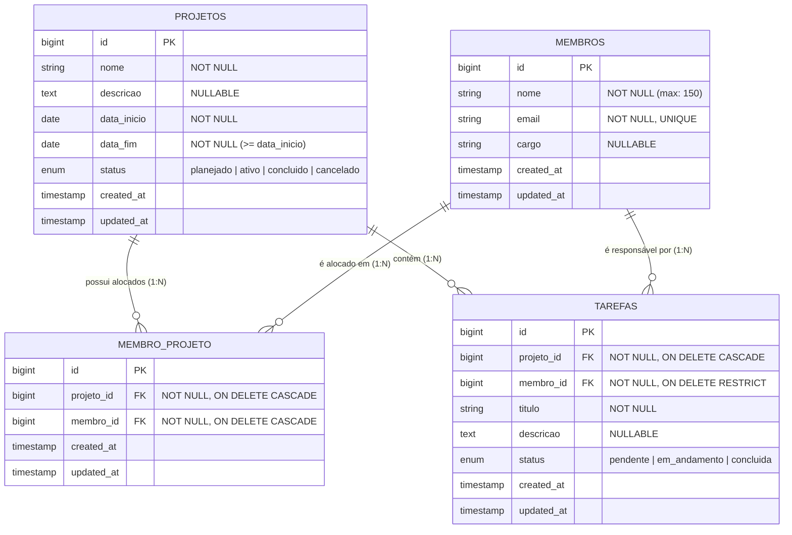

# Adapti Project Template
## Iniciando projeto
Clone o projeto para sua máquina:
```bash
    git clone link-do-projeto
```
### Laravel
Dentro da pasta `backend` siga as seguintes instruções.
1. Instale as dependências:
    ```bash
    composer install
    ```
2. Crie o arquivo de variáveis globais do projeto **backend**:
    ```bash
    cp .env.example .env
    ```
3. Após isso insira as credenciais do banco de dados no arquivo `.env`
4. Crie o schema no banco de dados. O nome do banco deve ser o valor contido na variável `DB_DATABASE` presente no arquivo `.env`. 
5. Gere a chave do projeto:
    ```bash
    php artisan key:generate
    ```
6. Crie o link simbólico com o diretório storage:
    ```bash
    php artisan storage:link
    ```
7. Rode as migrations:
    ```bash
    php artisan migrate --seed
    ```
   1. Caso as migrations já tenham sido rodadas anteriormente no seu banco de dados, execute o comando:
        ```bash
        php artisan migrate:fresh --seed
        ```
8. Inicie o servidor **backend**:
    ```bash
    php artisan serve
    ```
    1. O servidor **backend** será iniciado por padrão no endereço `http://127.0.0.1:8000`. 
### React.js/Next.js
Tenha o gerenciador de pacotes <a href="https://pnpm.io/pt/installation">pnpm</a> instalado globalmente em sua máquina.

Dentro da pasta `frontend` siga as seguintes instruções.
1. Instale as dependências:
    ```bash
    pnpm install
    ```
2. Crie o arquivo de variáveis globais do projeto **frontend**:
    ```bash
    cp .env.local.example .env.local
    ```
3. Inicie o servidor **frontend**:
    ```bash
    pnpm dev
    ```
    1. O servidor **frontend** será iniciado por padrão no endereço `http://127.0.0.1:3000`. 


# Decisões Arquiteturais e Modelagem de Dados
Esta seção documenta o processo de engenharia de requisitos, a modelagem relacional do banco de dados e as decisões arquiteturais adotadas para garantir a integridade dos dados e o cumprimento das regras de negócio da plataforma de gestão da EJ.

---

## 1 Como Cheguei à Modelagem (Do Relato ao Modelo Relacional)

A modelagem partiu da análise das dores operacionais relatadas pela Diretoria de Projetos(que seria o cliente do PS):
1. **Descentralização do acompanhamento diário:** Existiam apenas `Projetos` e `Membros`, sem granularidade das entregas. Isso levou à criação da entidade **`Tarefas` (`tasks`)**.
2. **Responsabilidade clara:** O relato exige que *"cada tarefa precisa ser obrigatoriamente atribuída a um membro específico"*. Portanto, na tabela de tarefas, a chave estrangeira `membro_id` foi definida como obrigatória (`NOT NULL`), estabelecendo uma relação **1:N** estrita entre Membro e Tarefas.
3. **Alocação em múltiplos projetos e controle de sobrecarga:** Como um projeto possui vários membros e um membro participa de vários projetos, consolida-se a relação **N:N** através da tabela associativa (pivô) `membro_projeto`, protegida por restrição de unicidade composta `UNIQUE (projeto_id, membro_id)` para impedir alocações duplicadas (RN07).

---

## 2. Levanatamento de Requisitos e Regras de Negócio
1. Levantamento de requisitos 
    Atores

        Diretor de Projetos: cadastra projetos, membros e tarefas e gerencia alocações.
        Sistema: aplica validações e a trava de alocação. 

2. Requisitos funcionais

    RF01  -  Cadastrar, editar, listar e excluir projetos, com validação de datas.

    RF02 - Cadastrar, editar, listar e excluir membros, com validação de dados.

    RF03 - Alocar e desalocar membros em projetos (relação N:N).

    RF04 - Bloquear a alocação de um membro em um 3º projeto ativo, com erro claro.

    RF05 - Cadastrar, editar, listar e excluir tarefas vinculadas a um projeto.

    RF06 - Atribuir cada tarefa a um membro (obrigatório).

    RF07 - Alterar o status de uma tarefa.

    RF08 - Filtrar tarefas por projeto, membro e status.

    RF09 - Exibir os erros de validação por campo e os erros da trava na tela, de forma amigável.


3. Requisitos não funcionais

    RNF01 - API REST em Laravel, front em Next.js, estilização apenas com Tailwind.

    RNF02 - Interface responsiva (mobile, tablet e desktop).

    RNF03 - Erros de validação em JSON, código HTTP 422, mensagens em português.

    RNF04 - A trava deve ser segura contra concorrência (transação e bloqueio de linha).

    RNF05 - Integridade garantida também no banco (FKs, unique, not null).

    RNF06 - Sem divergência de renderização entre servidor e cliente (hydration).


4. Regras de negócio

    RN01 - A data de término do projeto deve ser maior ou igual à data de início (vale no cadastro e na edição).

    RN02 - E-mail do membro é obrigatório, em formato válido e único. Nome é obrigatório, com tamanho máximo.

    RN03 - Uma tarefa pertence a exatamente um projeto. Um projeto tem zero ou mais tarefas.

    RN04 - Toda tarefa tem exatamente um membro responsável (membro_id obrigatório).

    RN05 - O responsável pela tarefa deve estar alocado no projeto da tarefa (decisão de projeto: evita tarefa para quem não participa).

    RN06 - Um projeto pode ter vários membros ao mesmo tempo.

    RN07 - Um membro não pode ser alocado duas vezes no mesmo projeto.

    RN08 - Um membro não pode estar alocado em mais de 2 projetos com status ativo simultaneamente.

    RN09 - A RN08 é verificada em dois momentos: ao alocar um membro a um projeto ativo e ao ativar um projeto que já tem membros. O projeto avaliado não conta na contagem prévia.

    RN10 - Projetos concluido, cancelado ou planejado não contam para o limite.

    RN11 - Não se criam tarefas em projeto concluido ou cancelado (decisão de projeto).

    RN12 - Não se desaloca um membro que ainda tenha tarefas não concluídas no projeto; elas devem ser reatribuídas antes (decisão de projeto).

    RN13 - Violações retornam 422 com mensagem clara, por exemplo: “Ana Souza já está alocada em 2 projetos ativos e não pode ser alocada em outro.” 

---

## 3. Diagrama Entidade-Relacionamento (DER)

Mermaid: É uma linguagem de texto para criar diagramas.
Eloquent: É o ORM do Laravel. ORM significa que ele traduz objetos PHP para o banco de dados e vice-versa, sem precisar escrever SQL na maioria dos casos.

O diagrama abaixo (renderizado via Mermaid) representa a estrutura física e lógica das tabelas e suas cardinalidades:



### Resumo dos Relacionamentos no Eloquent (Laravel)
* **`Projeto` (`Project`)**:
  * `belongsToMany(Membro::class, 'membro_projeto')`: Relação N:N de alocação da equipe.
  * `hasMany(Tarefa::class)`: Relação 1:N (um projeto possui zero ou muitas tarefas — **RN03**).
* **`Membro` (`Member`)**:
  * `belongsToMany(Projeto::class, 'membro_projeto')`: Relação N:N com os projetos em que atua.
  * `hasMany(Tarefa::class)`: Relação 1:N (um membro pode ser responsável por várias tarefas).
* **`Tarefa` (`Task`)**:
  * `belongsTo(Projeto::class)`: Toda tarefa pertence obrigatoriamente a um único projeto (**RN03**).
  * `belongsTo(Membro::class)`: Toda tarefa possui obrigatoriamente um único membro responsável (**RN04**).

---

# USOS DE IA